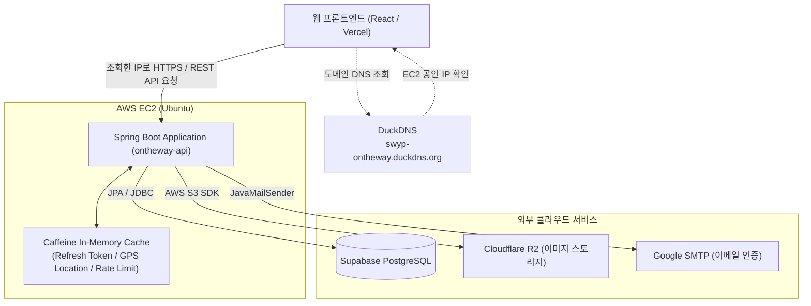
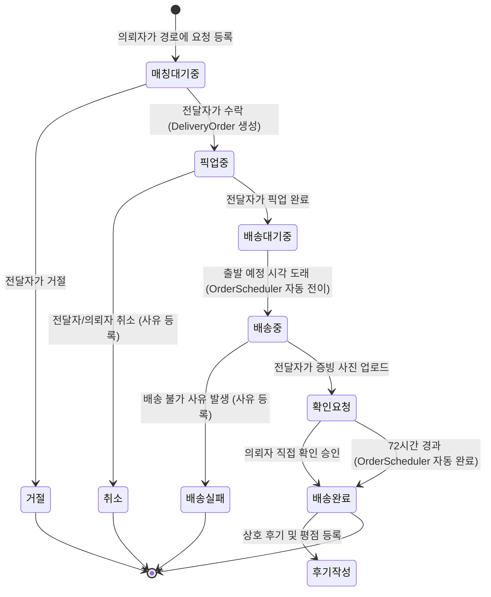
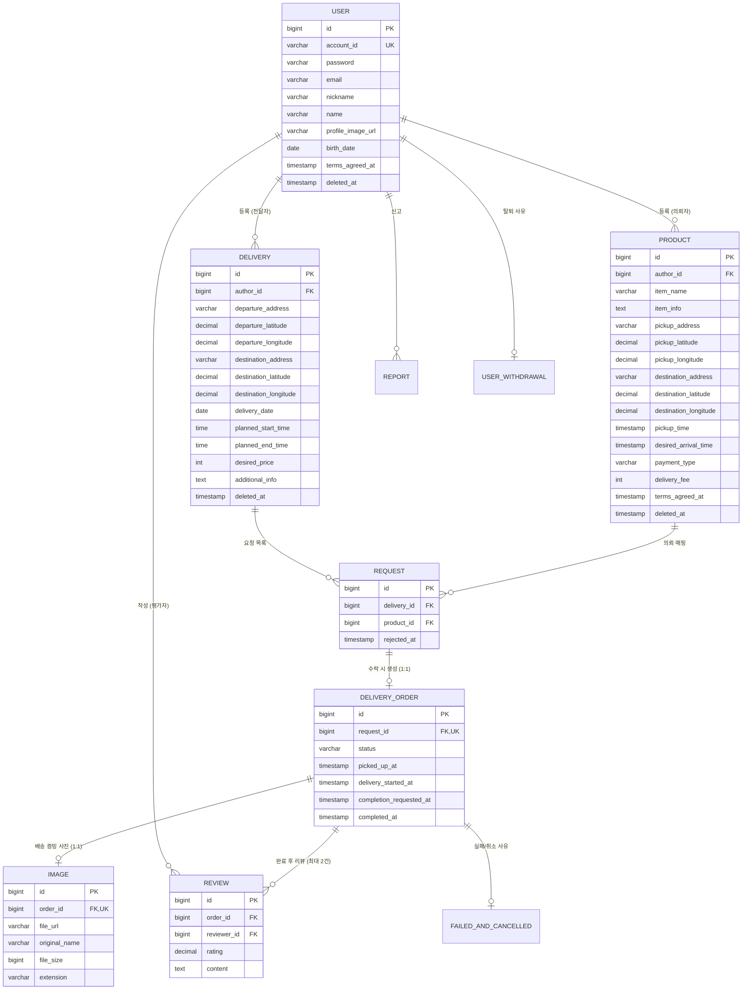
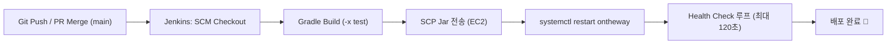

# 🚗 가는길에 (On The Way) - Backend API

> **"어차피 이동하는 길, 가볍게 전달하고 합리적으로 나누다"**  
> 이동 경로가 일치하는 전달자(이동자)와 물품 전달이 필요한 의뢰자를 연결해주는 **경로 기반 배송/심부름 매칭 중개 플랫폼**의 백엔드 REST API 서버입니다.

<br/>

[](https://www.oracle.com/java/)
[](https://spring.io/projects/spring-boot)
[](https://spring.io/projects/spring-security)
[](https://spring.io/projects/spring-data-jpa)
[](https://supabase.com/)
[](https://www.cloudflare.com/products/r2/)
[](https://github.com/ben-manes/caffeine)
[](https://swagger.io/)
[](https://www.jenkins.io/)

---

## 📌 목차
1. [서비스 소개](#-서비스-소개)
2. [주요 기능](#-주요-기능)
3. [기술 스택](#-기술-스택)
4. [시스템 아키텍처 & 플로우](#-시스템-아키텍처--플로우)
5. [데이터베이스 모델링 (ERD)](#-데이터베이스-모델링-erd)
6. [API 엔드포인트 명세](#-api-엔드포인트-명세)
7. [주요 설계 및 기술적 특징](#-주요-설계-및-기술적-특징)
8. [시작하기 & 환경 설정](#-시작하기--환경-설정)
9. [CI/CD & 배포 파이프라인](#-cicd--배포-파이프라인)
10. [프로젝트 구조](#-프로젝트-구조)

---

## 📖 서비스 소개

**"가는길에"**는 기존 퀵서비스나 택배의 비싼 비용 및 느린 배송 시간의 한계를 극복하기 위해 기획된 **C2C 공유 경제형 심부름/물품 배송 서비스**입니다.

- **전달자**: 출퇴근길, 등하굣길, 여행 등 기존 이동 동선에 맞는 의뢰를 수락하여 추가 수익을 창출합니다.
- **의뢰자**: 급하게 전달해야 하는 서류, 선물, 중고거래 물품, 음식 등을 저렴한 비용으로 빠르게 목적지까지 전달받습니다.
- **실시간 안심 배송**: 배송 중 전달자의 실시간 GPS 위치 추적과 증빙 사진 기반의 완료 확인 체계를 제공합니다.

---

## ✨ 주요 기능

### 1. 📍 경로 및 의뢰 매칭 시스템
- **이동 경로 등록 (전달자)**: 출발지/도착지 주소 및 위경도, 이동 일자, 출발/도착 예정 시각, 희망 배송비 등록
- **물품 의뢰 등록 (의뢰자)**: 물품명, 픽업지/도착지 주소 및 위경도, 픽업/희망 도착 시각, 배송비 등록
- **의뢰 신청 및 수락**: 의뢰자가 전달자의 이동 경로 게시글에 물품 의뢰를 요청하고, 전달자가 수락/거절

### 2. 🔄 배송 라이프사이클 관리
- `매칭대기중` ➡️ `수락(픽업중)` ➡️ `배송대기중` ➡️ `배송중` ➡️ `배송완료 확인요청` ➡️ `배송완료`
- **배송 취소/실패 처리**: 픽업 완료 전까지 취소 가능하며, 배송 실패 시 사유 기록 및 안전한 종료
- **스케줄러 자동 전이**:
  - 출발 예정 시각 도래 시 `배송대기중` ➡️ `배송중` 자동 전이
  - 증빙 사진 업로드 후 72시간 내 의뢰자 미확인 시 `확인요청` ➡️ `배송완료` 자동 확정

### 3. 🛰️ 실시간 GPS 위치 추적
- `배송중` 상태에서 전달자의 현재 GPS 좌표를 인메모리 캐시(`Caffeine`)에 주기적으로 갱신
- 의뢰자는 폴링 조회를 통해 전달자의 실시간 이동 위치를 지도상에서 확인 가능

### 4. 🔒 인증/인가 및 계정 보안
- **Spring Security + JWT**: Access Token(1시간) 및 HttpOnly Secure Cookie 기반 Refresh Token(14일)
- **토큰 로테이션 & 캐시 관리**: Refresh Token 갱신 및 재사용 방지/무효화
- **브루트포스 로그인 방지**: `Caffeine Cache` 기반 로그인 실패 횟수 제한 (5회 실패 시 60초간 잠금)
- **이메일 본인 인증**: Gmail SMTP를 통한 6자리 인증번호 발송 및 검증 (회원가입, 비밀번호 찾기)

### 5. 📸 미디어 및 파일 저장소
- Cloudflare R2 (AWS S3 호환) 오브젝트 스토리지 연동
- 회원 프로필 사진 업로드 및 배송 완료 증빙 사진(`image/jpeg`, `image/png`, `image/webp`) 안전 업로드

### 6. ⭐ 신뢰 및 평점/리뷰 & 신고 시스템
- 배송 완료 건에 대한 상호 5점 만점(0.5점 단위) 평점 및 후기 작성
- 사용자별 누적 평점 및 후기 통계 자동 산출
- 악성 유저 및 불량 게시글 신고 접수 기능

---

## 🛠 기술 스택

### Backend
| 구분 | 기술 / 라이브러리 |
|------|-------------------|
| **언어** | Java 21 |
| **프레임워크** | Spring Boot 3.x / 4.x |
| **보안 & 인증** | Spring Security, JJWT (io.jsonwebtoken 0.12.6) |
| **데이터 접근** | Spring Data JPA, Hibernate, QueryDSL/Custom Repository |
| **캐시** | Caffeine Cache |
| **메일** | Spring Mail (Gmail SMTP) |
| **API 문서** | Springdoc OpenAPI Starter WebMvc UI 3.1.1 (Swagger) |
| **유틸리티** | Lombok |

### Database & Storage
| 구분 | 기술 | 설명 |
|------|------|------|
| **RDBMS (Prod)** | Supabase PostgreSQL | 본 운영 데이터베이스 |
| **RDBMS (Local/Test)** | H2 Database | 인메모리 테스트 및 로컬 개발용 |
| **Object Storage** | Cloudflare R2 | S3 호환 프로필 및 배송 증빙 사진 저장 |

### Infrastructure & DevOps
| 구분 | 기술 |
|------|------|
| **서버 인프라** | AWS EC2 (Ubuntu) |
| **도메인 / DNS** | DuckDNS (도메인을 EC2 공인 IP로 연결) |
| **CI/CD** | Jenkins Pipeline (`Jenkinsfile`), GitHub Actions (PR & Label Sync) |
| **빌드 도구** | Gradle |

---

## 🏛 시스템 아키텍처 & 플로우

### 시스템 아키텍처



클라이언트는 DNS 조회를 통해 DuckDNS 도메인에 연결된 EC2 공인 IP를 확인한 뒤, EC2의 Spring Boot 애플리케이션으로 API를 요청합니다. 점선은 DNS 조회 흐름, 실선은 실제 서비스 통신을 나타내며, DuckDNS는 API 요청을 중계하지 않습니다.

### 배송 상태 전이 (Delivery Lifecycle)



---

## 🗄 데이터베이스 모델링 (ERD)



---

## 🔌 API 엔드포인트 명세

> 자세한 Request / Response 스펙은 서버 실행 후 **Swagger UI** (`/swagger-ui/index.html`)에서 확인하실 수 있습니다.

### 1. 회원 및 인증 (`/user`, `/email`)
| Method | Endpoint | 설명 | 인증 |
|---|---|---|---|
| `POST` | `/user/signup` | 신규 회원가입 | ❌ |
| `POST` | `/user/check/id` | 아이디 중복 확인 | ❌ |
| `POST` | `/user/login` | 로그인 (JWT Access Token & Refresh Cookie 발급) | ❌ |
| `POST` | `/user/logout` | 로그아웃 및 토큰 무효화 | ✅ |
| `POST` | `/user/reissue` | Access Token 재발급 | ❌ |
| `POST` | `/user/refresh-token/renew` | Refresh Token 갱신 | ✅ |
| `POST` | `/user/find/id` | 아이디 찾기 (이메일 인증 기반) | ❌ |
| `POST` | `/user/find/password` | 비밀번호 재설정 (임시 비밀번호 이메일 발송) | ❌ |
| `GET` | `/user/info` | 로그인 회원 정보 조회 | ✅ |
| `PATCH` | `/user/info` | 회원 정보 및 프로필 이미지 수정 | ✅ |
| `DELETE` | `/user/account` | 회원 탈퇴 | ✅ |
| `GET` | `/user/ratings` | 내 평점 요약 조회 | ✅ |
| `GET` | `/user/ratings/{userNo}` | 특정 사용자 평점 요약 조회 | ✅ |
| `POST` | `/email/auth` | 이메일 인증번호 발송 요청 | ❌ |
| `POST` | `/email/valid` | 이메일 인증번호 확인 | ❌ |

### 2. 이동 경로 게시글 (`/delivery`)
| Method | Endpoint | 설명 | 인증 |
|---|---|---|---|
| `GET` | `/delivery/list` | 이동 경로 게시글 목록 조회 (검색/필터) | ✅ |
| `GET` | `/delivery` | 이동 경로 게시글 상세 조회 | ✅ |
| `GET` | `/delivery/current` | 최근 등록한 내 이동 경로 조회 | ✅ |
| `POST` | `/delivery` | 이동 경로 게시글 등록 | ✅ |
| `PATCH` | `/delivery` | 이동 경로 게시글 수정 | ✅ |
| `DELETE` | `/delivery/{id}` | 이동 경로 게시글 삭제 (소프트 삭제) | ✅ |
| `GET` | `/delivery/me/list` | 내가 작성한 이동 경로 목록 조회 | ✅ |

### 3. 물품 의뢰 & 요청 (`/product`, `/request`)
| Method | Endpoint | 설명 | 인증 |
|---|---|---|---|
| `GET` | `/product/list` | 등록한 물품 게시글 목록 조회 | ✅ |
| `GET` | `/product` | 물품 게시글 상세 조회 | ✅ |
| `POST` | `/product` | 물품 게시글 등록 | ✅ |
| `PATCH` | `/product` | 물품 게시글 수정 | ✅ |
| `DELETE` | `/product/{id}` | 물품 게시글 삭제 | ✅ |
| `POST` | `/request` | 특정 이동 경로에 물품 배송 의뢰 요청 | ✅ |
| `GET` | `/request/list/{deliveryId}` | 이동 경로에 들어온 의뢰 요청 목록 조회 | ✅ |
| `PATCH` | `/request/{requestId}/reject` | 의뢰 요청 거절 | ✅ |

### 4. 배송 진행 로직 & 위치 (`/order`)
| Method | Endpoint | 설명 | 인증 |
|---|---|---|---|
| `POST` | `/order` | 배송 상태 전이 통합 처리 (수락, 픽업완료, 확인요청, 완료확인, 실패, 취소) | ✅ |
| `GET` | `/order/location` | 전달자 실시간 GPS 위치 조회 (의뢰자 전용, 배송중 전용) | ✅ |
| `PATCH` | `/order/location` | 전달자 실시간 GPS 위치 갱신 (전달자 전용, 배송중 전용) | ✅ |

### 5. 이용 내역, 후기 & 신고 (`/history`, `/review`, `/report`)
| Method | Endpoint | 설명 | 인증 |
|---|---|---|---|
| `GET` | `/history/list` | 전체 이용 내역 목록 조회 | ✅ |
| `GET` | `/history/delivery/list` | 전달자 이용 내역 목록 조회 | ✅ |
| `GET` | `/history/request/list` | 의뢰자 이용 내역 목록 조회 | ✅ |
| `GET` | `/history/cancel/list` | 취소/실패 내역 목록 조회 | ✅ |
| `POST` | `/review` | 거래 완료 건에 대한 후기 및 평점 작성 | ✅ |
| `GET` | `/review/me/list` | 내가 받은 후기 목록 조회 (페이징) | ✅ |
| `GET` | `/review/me/written` | 내가 작성한 후기 목록 조회 (페이징) | ✅ |
| `POST` | `/report/user` | 사용자 신고 접수 | ✅ |
| `POST` | `/report/board` | 게시글 신고 접수 | ✅ |
| `GET` | `/health` | 서버 헬스체크 | ❌ |

---

## 💡 주요 설계 및 기술적 특징

### 1. 직관적인 단일 상태 전이 엔드포인트 (`POST /order`)
- 프론트엔드의 복잡한 엔드포인트 분기를 줄이고, 요청 데이터의 의도(Intent)에 따라 안전하게 상태를 전이합니다:
  - `requestId` 존재 ➡️ **의뢰 수락** (동일 요청 중복 수락 방지 및 409 Conflict 처리)
  - `cancelReason` 존재 ➡️ **배송 취소** (픽업 완료 전만 허용)
  - `failReason` 존재 ➡️ **배송 실패**
  - `image` Multipart 존재 ➡️ **배송완료 확인요청** (증빙 사진 필수)
  - 본문 파라미터 없음 ➡️ 현재 상태 기반 전이 (`픽업중` ➡️ `배송대기중` 또는 `확인요청` ➡️ `배송완료`)

### 2. JPA 쿼리 최적화 & N+1 문제 방지
- 복합 연관관계를 갖는 엔티티 조회 시 불필요한 서브 쿼리 폭증을 방지하기 위해 `join fetch` 및 `@NamedEntityGraph`(`Review.WITH_PARTIES`)를 적극 적용하였습니다.
- 핵심 엔티티의 수정 시 파라미터 실수를 방지하기 위해 Java 21 `record`를 활용한 Value Object(VO) 캡슐화를 구성했습니다.

### 3. 고성능 인메모리 캐시(`Caffeine`) 전략
- **초저지연 GPS 위치 공유**: 배송 중 수시로 발생하는 위치 갱신/조회 트래픽을 DB 대신 Caffeine 캐시에 유지하여 DB I/O 부하를 제거했습니다.
- **보안 Rate Limiter**: 1분 내 로그인 5회 실패 시 즉각 차단하여 무차별 대입 공격(Brute Force)을 차단합니다.
- **인증 토큰 및 인증번호 관리**: Refresh Token 유효성 검사 및 6자리 이메일 인증코드 TTL 관리를 인메모리에서 신속하게 처리합니다.

### 4. 무중단 지연 방지를 위한 비동기/스케줄링 배치
- **`OrderScheduler`**:
  - 출발 시간이 도래한 배송건을 매 분 감지하여 `배송중`으로 자동 전환
  - 확인 요청 후 72시간 경과 건을 매일 자정 자동 완료 처리
  - 트랜잭션 락 충돌을 방지하기 위해 조건부 벌크 `UPDATE` 쿼리 기반 안전 처리

---

## 🚀 시작하기 & 환경 설정

### 1. 사전 요구사항
- **Java 21** 이상 (OpenJDK 21 권장)
- **Gradle 8.x** 이상 (프로젝트 내 `gradlew` 래퍼 포함)

### 2. 환경 변수 설정
로컬 실행 또는 운영 배포 시 다음 환경 변수를 주입해야 합니다:

```bash
# JWT Secret Key (Base64 인코딩된 256비트 이상 문자열)
export JWT_SECRET="your-jwt-secret-key-min-256-bit"

# Database (운영 프로덕션 배포 시 필수, 로컬은 H2 In-Memory 자동 사용)
export DB_PASSWORD="your-supabase-db-password"

# Gmail SMTP (이메일 인증코드 발송용)
export MAIL_USERNAME="your-gmail-account@gmail.com"
export MAIL_PASSWORD="your-gmail-app-password"

# Cloudflare R2 (이미지 스토리지)
export R2_ACCESS_KEY="your-r2-access-key"
export R2_SECRET_KEY="your-r2-secret-key"
export R2_ENDPOINT="https://<account-id>.r2.cloudflarestorage.com"
export R2_PUBLIC_URL="https://<your-custom-domain-or-r2-url>"
```

### 3. 로컬 개발 환경 실행

```bash
# 1. 저장소 클론
git clone https://github.com/Team-OnTheWay/ontheway-api.git
cd ontheway-api

# 2. 실행 권한 부여 (Unix/macOS)
chmod +x gradlew

# 3. 로컬 프로파일로 실행 (H2 DB 사용)
./gradlew bootRun --args='--spring.profiles.active=local'
```

- **API 서버 주소**: `http://localhost:8080`
- **Swagger UI**: `http://localhost:8080/swagger-ui/index.html`
- **H2 Web Console**: `http://localhost:8080/h2-console` (JDBC URL: `jdbc:h2:mem:testdb`, Username: `sa`, Password: 없음)

### 4. 테스트 및 빌드

```bash
# 테스트 실행
./gradlew test

# 운영 배포용 JAR 빌드
./gradlew clean build -x test
```

---

## 🚢 CI/CD & 배포 파이프라인

본 프로젝트는 Jenkins Pipeline을 기반으로 자동 빌드 및 배포가 구성되어 있습니다.



- **배포 호스트**: `ubuntu@swyp-ontheway.duckdns.org`
- **프로세스 관리**: Linux `systemd` 서비스 (`ontheway.service`)
- **Health Check**: `GET /health` 엔드포인트 응답 검증을 통해 배포 성공 여부 즉각 판별

---

## 📁 프로젝트 구조

```
ontheway-api/
├── .github/                 # GitHub Issue / PR 템플릿 & 라벨러 워크플로우
├── gradle/wrapper/          # Gradle Wrapper
├── Jenkinsfile              # Jenkins 배포 파이프라인 스크립트
├── build.gradle             # 프로젝트 의존성 및 빌드 설정
└── src/
    ├── main/
    │   ├── java/com/ontheway/
    │   │   ├── config/              # Swagger, JPA, R2, Scheduling 설정
    │   │   ├── controller/          # REST API 컨트롤러
    │   │   ├── dto/                 # Request / Response DTO
    │   │   ├── entity/              # JPA 엔티티 및 Embedded 객체
    │   │   ├── enums/               # 상태, 결제방식, 신고유형 등 열거형
    │   │   ├── global/              # 전역 예외처리, 공통 응답, Spring Security & JWT
    │   │   ├── infra/               # Caffeine 캐시, R2 스토리지, Mail 전송 구현체
    │   │   ├── repository/          # Spring Data JPA & Custom Repository
    │   │   ├── scheduler/           # 배송 상태 자동 전이 스케줄러
    │   │   ├── service/             # 비즈니스 서비스 로직
    │   │   └── OnthewayApplication.java
    │   └── resources/
    │       ├── application.properties        # 공통 프로퍼티 (스케줄러, JWT, R2, 메일)
    │       ├── application-local.properties  # 로컬 환경 (H2 In-Memory)
    │       └── application-prod.properties   # 운영 환경 (Supabase PostgreSQL)
    └── test/                                 # 단위 및 통합 테스트
```

---

## 👥 팀 정보 및 문의

- **팀명**: On The Way (가는길에)
- **프론트엔드 저장소**: [ontheway-fe](https://github.com/Team-OnTheWay/ontheway-fe)
- **백엔드 저장소**: [ontheway-api](https://github.com/Team-OnTheWay/ontheway-api)

<br/>

© 2026 Team OnTheWay. All rights reserved.
